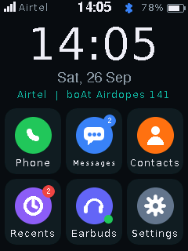
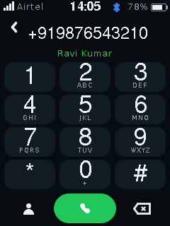
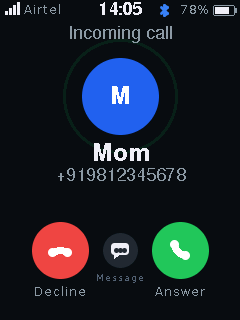
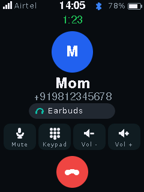
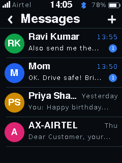
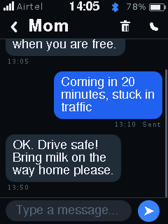
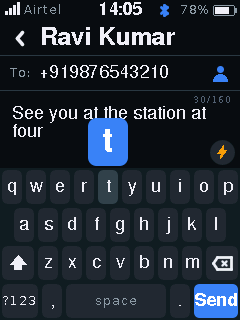
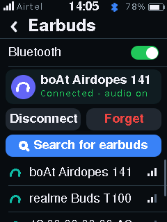

# TouchPhone

A working touchscreen **GSM phone** built from a LilyGO **T-Call** (ESP32 + SIM800L), a 2.4" ILI9341/XPT2046
touch display and your Airtel SIM. You operate it with the stylus. Calls work through **Bluetooth TWS
earbuds** (they are the speaker and microphone, and their buttons answer / hang up) or a wired speaker + mic.

<p>




</p>
<p>




</p>

*(Real screenshots of the firmware's UI, rendered on a PC by `tools/uisim.ps1` – see all 27 in [docs/screens](docs/screens).)*

## Features

**Calls** – touch dialer (hold 0 for +), outgoing / incoming calls, answer, decline, decline-with-SMS
quick replies, mute, in-call keypad (DTMF for IVR menus), call timer, volume, switch earbuds ↔ wired
during a call, redial, emergency 112 from the lock screen, "return to call" banner.

**Messages** – conversation view with chat bubbles, SMS composer with character / part counter,
**long SMS** (joined automatically), **Unicode** (Hindi, ₹, emoji are received correctly), sender IDs
like `AX-AIRTEL`, delivery status and one-tap resend, quick replies, call a number found in a message.

**Contacts & recents** – add / edit / delete / search, pick contacts when calling or texting,
**import contacts from the SIM**, call history with missed calls, call back from the list.

**Earbuds** – Bluetooth scan & pair, auto-reconnect, earbud ring tone, answer / hang up / redial /
volume from the earbud buttons, test tone and mic-echo tests, live audio level meters.

**Phone stuff** – lock screen with hold-to-unlock, notification cards and blue notification LED,
screen timeout, brightness, network time (NITZ, or taken from incoming SMS), **balance / USSD codes**
(`*123#`, interactive `*121#` menus), SIM PIN entry, network / SIM / battery info, 4-point touch
calibration, factory reset, USB debug console.

**Robustness** – the modem runs in its own FreeRTOS task (the UI never freezes waiting for AT
commands), automatic modem recovery, SMS kept on the SIM until safely stored, crash-safe storage,
no flash writes during calls, privacy-masked logs, no internet or cloud needed.

## Hardware

| You have | Notes |
|---|---|
| LilyGO T-Call SIM800L | ESP32 + SIM800L 2G modem + battery charger |
| 2.4" SPI TFT 240×320 (ILI9341) with XPT2046 touch + stylus | 11 wires to the T-Call |
| Airtel SIM | 2G GSM network |
| TWS earbuds | any earbuds with a microphone (HFP) |
| **Also needed** | GSM antenna (comes with the T-Call), 3.7 V Li-ion battery, and 5 resistors + 6 capacitors (about ₹50) for earbud calls |

👉 **Wiring, pin map and the audio circuit: [docs/HARDWARE.md](docs/HARDWARE.md)**

## Quick start

```powershell
# 1. one-time: fetch the pinned display library (and the ESP32 core if missing)
powershell -File tools\setup.ps1

# 2. build
powershell -File tools\build.ps1

# 3. flash + open the debug console (replace COM5 with your port)
powershell -File tools\build.ps1 -Upload -Port COM5 -Monitor
```

Then follow **[docs/TESTING.md](docs/TESTING.md)** – it tests the phone in 10 small stages
(modem → SMS → calls → display → touch → UI → earbuds → audio), with the exact output to expect.

Build settings used: board *ESP32 Dev Module*, PSRAM **enabled**, partition **Huge APP (3 MB, no OTA)**,
Arduino-ESP32 core **3.3.8**, LovyanGFX **1.2.30**. (In the Arduino IDE, choose the same options and
copy `LovyanGFX` into your libraries folder.)

## How it works

```
 ┌────────────── ESP32 ───────────────────────────────────────────────┐
 │  UI task (core 1)            Modem task (core 1)    Bluetooth (core 0)│
 │  touch → screens → display   AT engine, URCs,       GAP pairing,      │
 │  call log, notifications     calls, SMS PDU,        HFP audio gateway │
 │        ▲    │                USSD, recovery               │           │
 │        │    └── commands ──►  ▲    │                      │           │
 │        └──────── events ◄─────┴────┴──────── events ◄─────┘           │
 │                                                                        │
 │  Audio task + timer ISR: SIM800L SPK ─ADC─► filter ─► earbuds          │
 │                          earbud mic ─► gain ─DAC─► SIM800L MIC         │
 └────────────────────────────────────────────────────────────────────────┘
        │ UART 26/27                 │ SPI                  │ Bluetooth HFP
     SIM800L ── 2G ── Airtel      ILI9341 + XPT2046      TWS earbuds
```

```
firmware/TouchPhone/
  TouchPhone.ino            entry point
  src/config/               board_config.h (every GPIO), app_config.h (limits, debug flags)
  src/core/                 events, logging, text/UTF-8/time helpers, lock-free ring buffer
  src/modem/                SIM800L task, AT parser, SMS PDU codec, long-SMS assembler
  src/bt/                   Bluetooth GAP + HFP Audio Gateway
  src/audio/                SIM800L <-> Bluetooth audio bridge, DSP (filters, gains)
  src/hw/                   display (LovyanGFX), touch + calibration, power chip
  src/store/                contacts, messages, call log (LittleFS), settings (NVS)
  src/ui/                   GUI toolkit, keyboard, icons, all screens
  src/app/                  main loop, phone logic, serial console
tests/host/                 127 PC unit tests (tools/test.ps1)
tests/uisim/                PC screen simulator (tools/uisim.ps1)
docs/                       HARDWARE.md, TESTING.md, screenshots
```

## Honest limitations

* **2G only.** The SIM800L cannot use 4G/VoLTE. It works where Airtel still has 2G; check the signal
  in Settings → Network & SIM at your location.
* **Earbud calls need the small audio circuit** from HARDWARE.md. The SIM800L's audio is analog and
  cannot be connected to Bluetooth directly. Sound quality is normal phone quality, not hi-fi.
* **Hindi and other non-Latin scripts** are received, stored and forwarded correctly, but the display
  fonts show them as `?` (numbers and English words in the same message still show). Typing is English/ASCII.
* No mobile data, apps, WhatsApp or internet – this is a calls + SMS phone.
* No built-in ringer speaker: the earbuds ring, the blue LED blinks and the screen wakes. A small
  speaker on the SIM800L SPK pads also plays the ring tone.
* **Not yet tested on real hardware.** Everything compiles, the logic is unit-tested and the screens
  were checked in the simulator, but pin numbers, audio levels and timings must be confirmed on your
  board with docs/TESTING.md.
