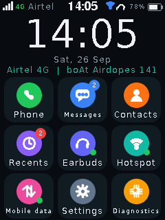
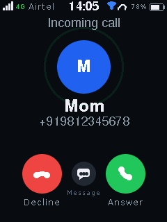
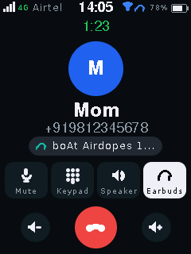
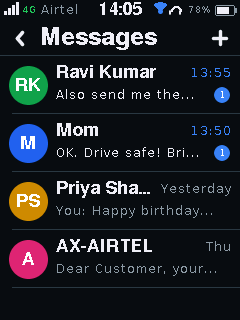
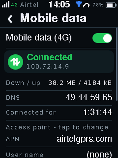
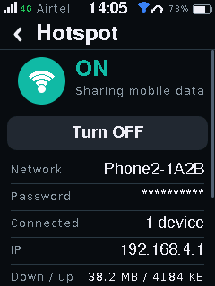
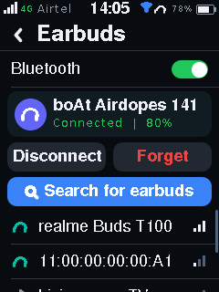
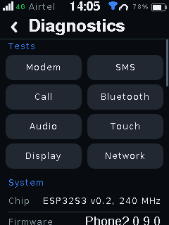

# Phone2 – a DIY 4G touchscreen phone

A standalone phone built from an **ESP32-S3**, a generic **ESP32**, a **SIMCom A7672S**
4G module, a 2.4" ILI9341 touchscreen and an Airtel SIM. Calls work through **TWS
earbuds** (Bluetooth HFP) or a wired handset, and the phone can share its **4G data over
a Wi-Fi hotspot**.

<p>




</p>
<p>




</p>

*(Real screenshots of the firmware's UI, rendered on a PC by `tools/uisim.ps1` – all 36 in [docs/screens](docs/screens).)*

> **Status: code complete, not yet tested on hardware.** Both firmwares build with zero
> warnings (ESP-IDF 5.5.5), 405 PC unit tests pass and all screens were checked in the
> simulator. Pins, voltages, audio levels and timings must now be confirmed on the real
> boards – follow [docs/TESTING.md](docs/TESTING.md). Everything marked UNVERIFIED in the
> docs is exactly that.

## Features

**Calls** – dialer (hold 0 for +), incoming / outgoing, answer, decline, decline with SMS,
mute, speaker, earbuds ↔ handset switching during the call, in-call keypad (DTMF),
volume, call timer, redial, emergency 112 from the lock screen, "return to call" banner.

**Earbuds (TWS, Bluetooth HFP)** – search / pair / connect / forget, auto-reconnect, the
earbuds ring with caller ID, their buttons answer / hang up / redial / change volume,
earbud battery % (when the earbuds report it), test tone and mic-echo tests, live levels.

**Messages** – conversations, long SMS joined automatically, Unicode (Hindi, ₹, emoji)
received correctly, operator senders like `AX-AIRTEL`, delivery failure + resend, quick
replies, unread badges and notifications.

**Contacts & recents** – add / edit / delete / search, SIM phone-book import, call history
with missed calls, call back.

**4G data & hotspot** – PPP over the modem UART on a second CMUX channel (calls and SMS
keep working), APN / user / password settings, data counters, internet test, Wi-Fi
hotspot (WPA2, random password, up to 8 devices) sharing the 4G link with NAT, automatic
recovery when the network drops.

**Phone stuff** – status bar (signal, 4G/2G, operator, clock, hotspot, earbuds, battery),
lock screen, BOOT button = home / wake / lock, screen timeout, brightness, network time
(NITZ + internet), balance / USSD codes, SIM PIN, network mode (Auto / 4G / 2G),
diagnostics with hardware tests and an on-screen log, RGB notification LED, optional
buzzer ringtone, USB debug consoles on both boards.

**Robustness** – modem start-up state machine with timeouts, failure reasons and
automatic power-cycle recovery; the UI never waits for the modem; SMS kept on the SIM
until stored; crash-safe storage; no flash writes during calls; PINs and passwords never
logged, numbers masked; core dump kept after a crash.

## Hardware

| Part | Job |
|---|---|
| ESP32-S3 (N16R8) | the phone: UI, modem, SMS, 4G data, hotspot |
| generic ESP32 (WROOM-32) | Bluetooth Classic helper: HFP for the earbuds + call-audio bridge |
| SIMCom A7672S on the "LASPLO076_RevB" board | 4G LTE Cat-1 + 2G: calls, SMS, data |
| 2.4" SPI TFT 240×320 (ILI9341) + XPT2046 touch | screen + stylus |
| TWS earbuds | speaker + mic for calls |
| a few resistors / capacitors | the audio bridge ([docs/AUDIO_ARCHITECTURE.md](docs/AUDIO_ARCHITECTURE.md)) |

**Why two ESP32s?** TWS earbuds need Bluetooth **Classic** (HFP) for calls – the ESP32-S3
only has Bluetooth LE. The plain ESP32 has Classic but not enough RAM for everything, and
it would have to share one radio between the hotspot and the earbuds. So the S3 is the
phone and the ESP32 is a small Bluetooth co-processor; they talk over 3 wires.

👉 **Before wiring: [docs/HARDWARE.md](docs/HARDWARE.md)** – the carrier board is not documented
online, and a few photos/measurements are needed (section 5 there).

## Quick start

```powershell
# 1. one-time: ESP-IDF 5.5.5 + LovyanGFX + LittleFS (kept outside OneDrive)
powershell -File tools\setup.ps1

# 2. build both firmwares
powershell -File tools\build.ps1

# 3. flash + console (use your COM ports)
powershell -File tools\build.ps1 -Target bt   -Flash -Port COM5 -Monitor
powershell -File tools\build.ps1 -Target main -Flash -Port COM7 -Monitor

# PC-only checks
powershell -File tools\test.ps1       # 405 unit tests
powershell -File tools\uisim.ps1      # render all screens to docs\screens
```

## Documentation

| Document | Contents |
|---|---|
| [docs/HARDWARE.md](docs/HARDWARE.md) | parts, confidence table, A7672S facts, what to measure / photograph |
| [docs/PINMAP.md](docs/PINMAP.md) | every GPIO and wire |
| [docs/ARCHITECTURE.md](docs/ARCHITECTURE.md) | design, tasks, events, state, error handling, security, milestones |
| [docs/MODEM.md](docs/MODEM.md) | A7672S driver: state machine, AT commands, CMUX, PPP, calls, SMS |
| [docs/AUDIO_ARCHITECTURE.md](docs/AUDIO_ARCHITECTURE.md) | analog audio ↔ HFP bridge, RC networks, rates, latency, echo |
| [docs/BLUETOOTH.md](docs/BLUETOOTH.md) | HFP Audio Gateway, pairing, SCO policy, S3↔ESP32 link protocol |
| [docs/HOTSPOT.md](docs/HOTSPOT.md) | SoftAP + NAPT, settings, speed, recovery, laptop test |
| [docs/POWER.md](docs/POWER.md) | current budget, bench and battery power, Li-Po checks |
| [docs/TESTING.md](docs/TESTING.md) | PC tests + hardware tests TEST-001 … TEST-016 |

## Honest limitations

* **Not tested on hardware yet** (see the status box above).
* The carrier board's pinout, UART level, PWRKEY wiring and audio pads are **UNKNOWN**
  until you check them – the firmware keeps all of them configurable.
* **4G speed through the hotspot is limited by the modem UART**: ≈ 85 kbit/s at the
  default 115200 baud, ≈ 650 kbit/s at 921600 if the carrier board's level shifter allows
  it. A USB-host link from the S3 (future) would be much faster.
* **Voice on Airtel 4G** needs VoLTE in the module firmware or a fall-back to 2G; "Auto"
  network mode allows the fall-back (UNVERIFIED which one your module uses).
* Earbud audio goes through the ESP32's 8-bit DAC / 12-bit ADC: normal phone quality,
  not hi-fi. An I2S codec is the planned upgrade.
* Hindi and other non-Latin scripts are stored and sent correctly but the screen fonts
  show them as `?`. Typing is English.
* Battery power is designed only as requirements ([docs/POWER.md](docs/POWER.md)); no sleep
  modes yet, so battery life is hours, not days.
* No apps, no WhatsApp: this is a calls + SMS + internet-sharing phone.
