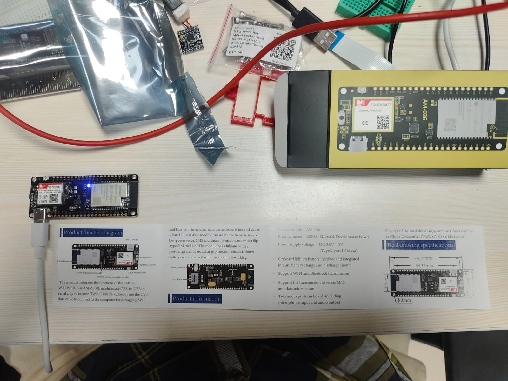
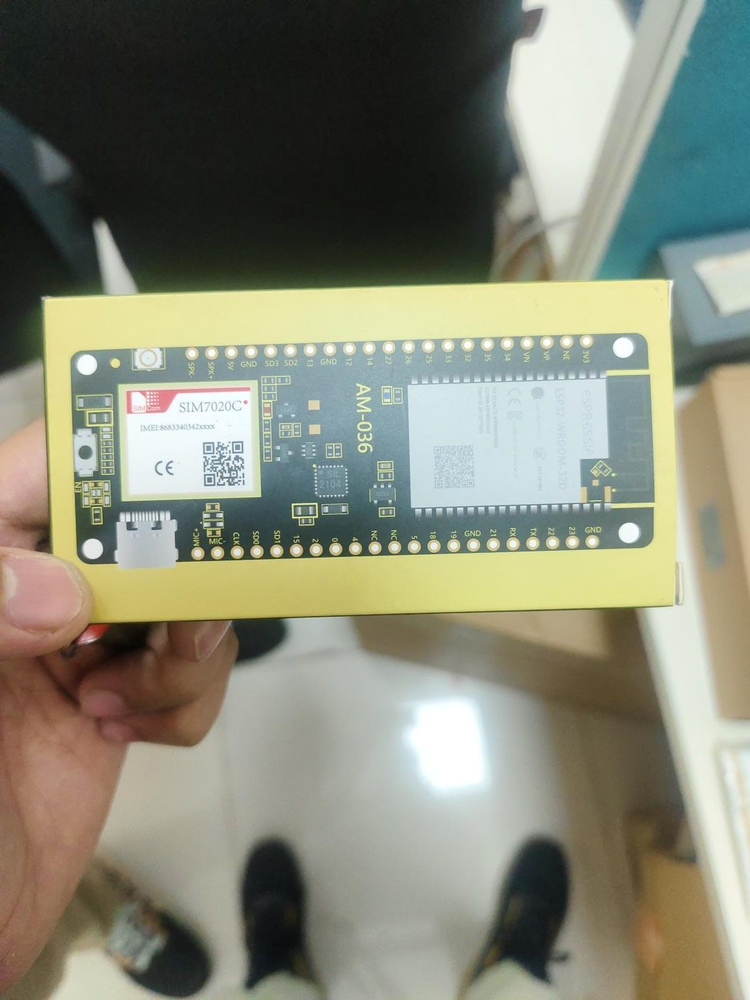

# ESP32 Touch Phones

DIY touchscreen phones powered by ESP32 microcontrollers, cellular modems, and touch displays.

## Hardware Preview

  
  

## Sub-Projects

### 1. [Phone1 (TouchPhone)](Phone1/)
- **Microcontroller**: LilyGO T-Call (ESP32 + SIM800L 2G GSM)
- **Display**: 2.4" ILI9341 touchscreen with XPT2046 controller
- **Audio**: Bluetooth TWS earbuds (HFP) or wired speaker/mic
- **Features**: Touch dialer, calls, SMS (long SMS & Unicode support), contacts, settings, touch UI simulator
- Read more: [Phone1 README](Phone1/README.md) | [Hardware Guide](Phone1/docs/HARDWARE.md) | [Testing](Phone1/docs/TESTING.md)

### 2. [Phone2 (DIY 4G Phone)](Phone2/)
- **Architecture**: Dual-MCU architecture (ESP32-S3 main processor + ESP32 Bluetooth coprocessor)
- **Cellular**: SIMCom A7672S 4G LTE module
- **Display**: 2.4" ILI9341 touchscreen with XPT2046 controller
- **Audio & Connectivity**: Bluetooth HFP audio to TWS earbuds, Wi-Fi hotspot sharing 4G data
- **Features**: Complete touch phone app, dialer, messaging, diagnostics, PC unit tests and UI simulator
- Read more: [Phone2 README](Phone2/README.md) | [Hardware Guide](Phone2/docs/HARDWARE.md) | [Testing](Phone2/docs/TESTING.md)
